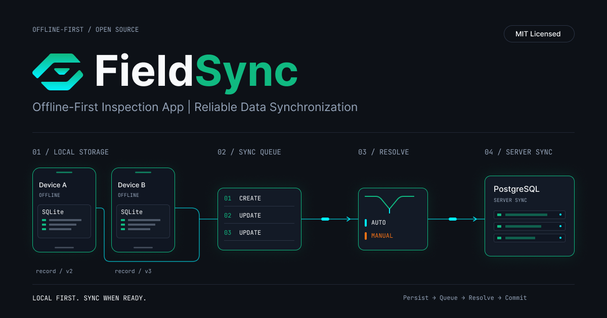

# FieldSync

**Offline-first inspection app for unreliable networks.**

FieldSync lets technicians create inspections, checklists and photo reports with no connectivity, keeps them durably on the device, and synchronises them later without losing data or silently overwriting a colleague's changes.

[](https://github.com/Dieu-Merci-Ndenga/fieldsync/actions/workflows/ci.yml)
[](LICENSE)

<p align="center">
  <a href="https://github.com/Dieu-Merci-Ndenga/fieldsync">
    
  </a>
</p>

## Why FieldSync Exists

A typical mobile app assumes the network is available. On site (basements, plants, rural areas) it is not: requests drop mid-flight, apps are killed, and two people edit the same record while both are offline.

FieldSync is designed around **local-first writes**, **idempotent operations** and **explicit conflict resolution**. Exactly-once delivery cannot be guaranteed over an unreliable network, so every operation carries a UUID and the server makes replays harmless.

## Core Capabilities

- Create and edit inspections, checklists, notes and photos fully offline.
- Persistent local storage (SQLite) that survives restarts and app kills.
- Ordered sync queue (outbox) with automatic resume after network interruption.
- Idempotent push: replaying an operation never duplicates its effect.
- Field-level three-way merge: edits to different fields merge automatically.
- Conflict detection when two users change the same field, with _keep mine / keep theirs_ resolution.
- Append-only change history (author, version, auto-merged flag).
- Sync indicators: per-record `synced / pending / conflict`, global offline/syncing/error banner.
- Idempotent photo upload with content validation; a permanently rejected photo is parked with a Retry/Remove action and never blocks data sync.
- Search, status and sync-state filters; soft delete and restore (with Undo) for inspections, checklist items and photos.
- Light/dark themes, accessible controls, and a browser build for quick desktop testing.
- Fail-fast production configuration, input validation, security headers.

## Quick Start

```bash
docker compose up -d --build                 # API on :3000 + PostgreSQL
./demo/conflict-demo.sh                      # offline replay, auto-merge and a conflict, from the shell
cd mobile && npm install && npx expo start   # then scan the QR code with Expo Go (SDK 58)
```

No phone at hand? Run `npx expo start --web` and open <http://localhost:8081> (see [Browser](#browser-expo-web)).

## Design Decisions

| Decision                                  | Rationale                                                                                              |
| ----------------------------------------- | ------------------------------------------------------------------------------------------------------ |
| Write-ahead local outbox                  | An edit is durable before any network call, so a crash or dead zone never loses work.                  |
| Idempotent operations (UUID + ledger)     | Exactly-once delivery is impossible; at-least-once plus a `processed_ops` ledger is safe and simple.   |
| Field-level three-way merge               | Different fields edited by different people merge silently; only real collisions reach the user.       |
| Conflicts are parked, never auto-resolved | "No silent overwrite" is the product promise; the user chooses _keep mine_ or _keep theirs_.           |
| Tombstones instead of hard deletes        | Deletes sync, merge and conflict like any edit, and can be undone.                                     |
| Photos are a separate queue               | A broken or large upload can never block data sync; permanent rejections are parked with Retry/Remove. |
| Pure, dependency-free `SyncEngine`        | Runs against an in-memory store and a fake server in tests, with the real merge code.                  |

## Architecture

```text
 Mobile (Expo / React Native)                     Server
┌──────────────────────────────┐        ┌───────────────────────────┐
│ UI ─► SyncEngine ─► SQLite   │  HTTPS │ NestJS API                │
│        │   inspections       │◄──────►│  POST /sync/push          │
│        │   outbox (ops)      │        │  GET  /sync/pull          │
│        │   photos queue      │        │  PUT  /photos/:id         │
│        └─ retry / resume     │        │  GET  /inspections/:id/…  │
└──────────────────────────────┘        └────────────┬──────────────┘
                                                      │ transaction + row lock
                                                      ▼
                                   PostgreSQL: inspections, change_log,
                                               processed_ops, photos
```

### Project Stack

| Technology          | Role                                              |
| ------------------- | ------------------------------------------------- |
| TypeScript          | Shared language across app and API                |
| React Native (Expo) | Mobile client                                     |
| SQLite              | Durable on-device store and outbox                |
| NestJS              | HTTP API, guards, dependency injection            |
| PostgreSQL          | Source of truth, history and idempotency ledger   |
| Docker              | Reproducible PostgreSQL + API                     |
| GitHub Actions      | CI: build, tests on real PostgreSQL, lint, Docker |

```text
backend/    NestJS API (src/sync/merge.ts holds the merge algorithm)
mobile/     Expo app
  src/core      sync engine, store contracts, in-memory store (framework-free, unit tested)
  src/db        SQLite store (native) and localStorage store (web)
  src/platform  native/web adapters: binary upload, photo storage, settings
  src/ui        themed components and screens
demo/       Scripted reproduction of offline replay, auto-merge and conflict
```

## How Synchronisation Works

1. **Write locally.** Every edit appends an operation `{opId, inspectionId, baseVersion, patch}` to the SQLite outbox _before_ any network call and updates the local view.
2. **Push.** The engine sends pending operations in order. The server locks the inspection row, merges inside a transaction, appends to `change_log` and records the `opId` in `processed_ops`.
3. **Merge.** If `baseVersion` is current the patch is applied. Otherwise the server compares the patch with changes made by _other_ users since `baseVersion`: disjoint fields auto-merge, identical values are accepted, differing values become a **conflict**.
4. **Resolve.** Conflicting operations are parked (not applied) and the UI shows _mine vs theirs_. **Keep mine** replays the operation with `force`; **Keep theirs** discards it.
5. **Resume.** Network errors abort the run and mark the app offline; the same operations are retried on reconnect, every 15 s, or on _Sync now_. Lost responses are safe because of `processed_ops`.
6. **Pull.** The device fetches inspections changed since its cursor, re-applies its still-pending operations on top, and shows server values for conflicting fields.

Checklist items and photos are stored as separate fields (`item:<id>`, `photo:<id>`), so adding items concurrently never conflicts.

## API

All routes except `/health` need `Authorization: Bearer <API_TOKEN>` when configured (mandatory in production). Mutating routes need `x-user-id`.

### Push operations

```http
POST /sync/push
{ "ops": [{ "opId": "<uuid>", "inspectionId": "<uuid>", "baseVersion": 1,
            "patch": { "notes": "valve leaking" }, "force": false }] }
```

Returns one result per op:

```json
[{ "opId": "…", "status": "applied", "version": 3, "merged": true }]
[{ "opId": "…", "status": "conflict", "serverVersion": 3,
   "conflicts": [{ "field": "notes", "mine": "a", "theirs": "b" }] }]
```

### Other routes

- `GET /sync/pull?cursor=` → `{ cursor, more, inspections[] }` changed since the change-log cursor.
- `GET /inspections/:id/history` → ordered change log.
- `PUT /photos/:id?inspectionId=` raw `image/jpeg|png` (idempotent), `GET /photos/:id`.
- `GET /health`.

## Security

See [SECURITY.md](SECURITY.md) for the full model. In short: bearer token (required in production), validated identifiers and field names, size limits, verified photo content, security headers, non-root container, fail-fast production config.

## Local Development

Requirements: Node.js 22, npm and Docker.

```bash
docker compose up -d --build      # API :3000 (token: dev-token-change-me), Postgres :5432
cd mobile && npm install && npx expo start
```

See [.env.example](.env.example) for all configuration. In the app's _Settings_ set the server URL (Android emulator `http://10.0.2.2:3000`, real device: your LAN IP), the API token, and a user name. Use a different user on a second device to produce conflicts. _Simulate offline_ forces offline mode for demos.

### Browser (Expo web)

```bash
cd mobile && npx expo start --web     # http://localhost:8081
```

The web build uses `localStorage` instead of SQLite and stores photos as data URLs (quota-limited), so it is a development convenience, not a production target. The API must allow the origin (`CORS_ORIGIN=*` is the compose default for local demos). Settings are stored in the device secure store (native) or `localStorage` (web).

### Android APK

```bash
cd mobile
npm install -g eas-cli && eas login
EXPO_PUBLIC_API_URL=https://your-api.example.com EXPO_PUBLIC_API_TOKEN=<token> eas build -p android --profile preview
```

The `preview` profile ([eas.json](mobile/eas.json)) produces an installable `.apk`; EAS prints a download link. The API URL is baked in at build time and must be **HTTPS** (Android release builds block cleartext HTTP); it can still be changed in _Settings_.

### Scripted demonstration

```bash
./demo/conflict-demo.sh
```

Shows creation, idempotent replay, auto-merge of different fields, a conflict on the same field, and the history.

## Tests and Build

```bash
npm install && npm install --prefix backend && npm install --prefix mobile
docker compose up -d db
npm run lint
npm run format:check
npm run build
npm run test:e2e              # backend unit + API e2e against real PostgreSQL
npm test --prefix mobile      # sync engine: offline, resume, lost response, conflicts
```

Backend e2e tests are skipped when `DATABASE_URL` is unset; `npm run test:e2e` sets the local default. The mobile tests run the real merge algorithm inside an in-process fake server.

## Limitations

FieldSync is a reference implementation, not a complete field-service platform.

- **Identity is not authentication:** one shared `API_TOKEN` plus an `x-user-id` label. No users, roles or per-user permissions.
- **Per-operation resolution:** a conflict is resolved for the whole operation, not field by field.
- **Keep mine overwrites:** it replaces the server's value for the conflicting fields (the history keeps the overwritten change).
- **Soft deletes only:** deletion is a synced `deleted` flag (and `null` tombstones for checklist items and photos); data is never purged and photo files stay on the server.
- **Text fields merge as whole values:** no character-level merge of notes.
- **Schema management:** TypeORM `synchronize: true` instead of migrations.
- **Photos:** stored on the API's local volume; no thumbnails, compression pipeline or object storage. Pulled inspections show remote photos only while online.
- **No background sync:** sync runs while the app is open.
- **Device data is not encrypted** at rest.
- **Test coverage:** the sync engine and server merge/API are tested; the React Native UI and the SQLite adapter have no automated tests. The app has been exercised manually in Expo Go on an Android device and in a desktop browser, not on iOS.
- **Web build:** `localStorage` persistence and data-URL photos are quota-limited; it is for development only.
- **Not load tested.**

## Changelog

### Unreleased

- **Sync:** outbox, idempotent push, field-level three-way merge, conflict resolution, change history, cursor-based pull.
- **Mobile:** themed UI with search/filters, delete/restore with Undo, photo viewer (fit / 100%), native binary photo upload, web build, SQLite persistence, photo capture and queued upload, sync indicators, offline simulation.
- **Security:** bearer `API_TOKEN` (required in production), request validation, photo content checks, security headers, non-root container.
- **Tooling:** CI with PostgreSQL service, oxlint, Prettier, demo script, contribution and security policies.

## Troubleshooting

| Symptom                            | Likely cause and fix                                                                                        |
| ---------------------------------- | ----------------------------------------------------------------------------------------------------------- |
| Phone shows "something went wrong" | The app cannot reach the API. Use a URL reachable from the phone (LAN IP or a public tunnel) in _Settings_. |
| `401` from the API                 | The API token in _Settings_ does not match `API_TOKEN`.                                                     |
| Browser blocks requests (CORS)     | Set `CORS_ORIGIN` to the web origin, or `*` for local demos only.                                           |
| A photo shows "Upload failed"      | The server rejected the file (type, size or content). Use _Retry_ or _Remove_; data sync is unaffected.     |
| Everything works but nothing syncs | _Simulate offline_ is enabled in _Settings_.                                                                |

## Contributing and License

See [CONTRIBUTING.md](CONTRIBUTING.md) and the [Code of Conduct](CODE_OF_CONDUCT.md). Released under the [MIT License](LICENSE).
